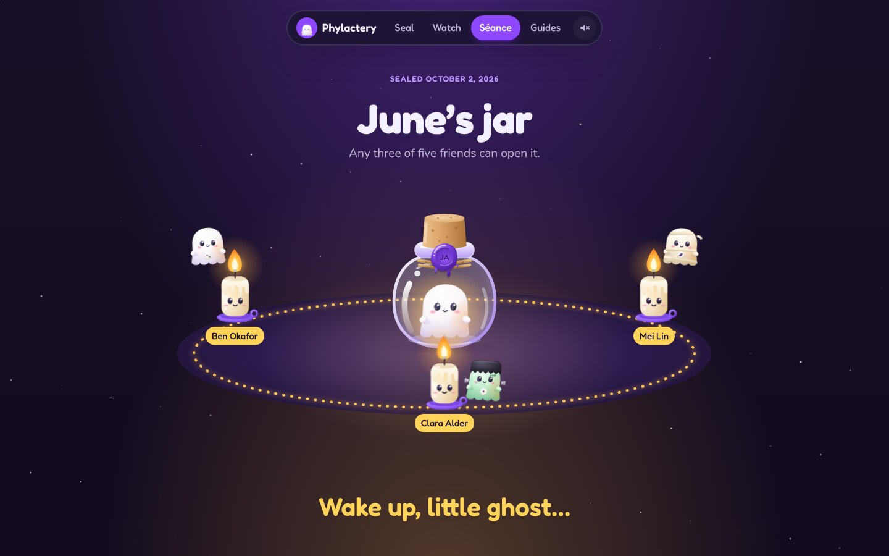
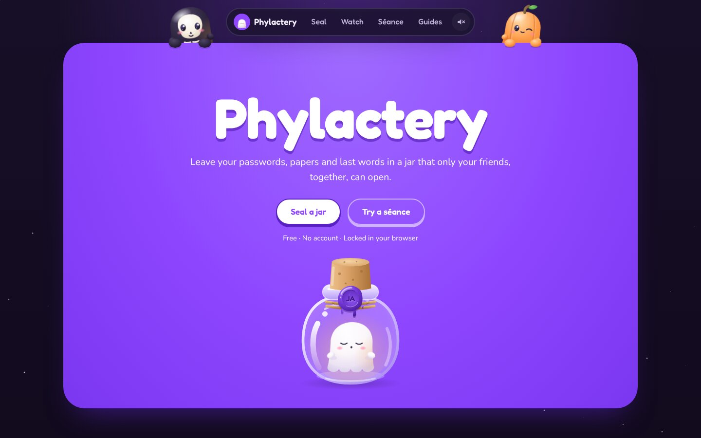
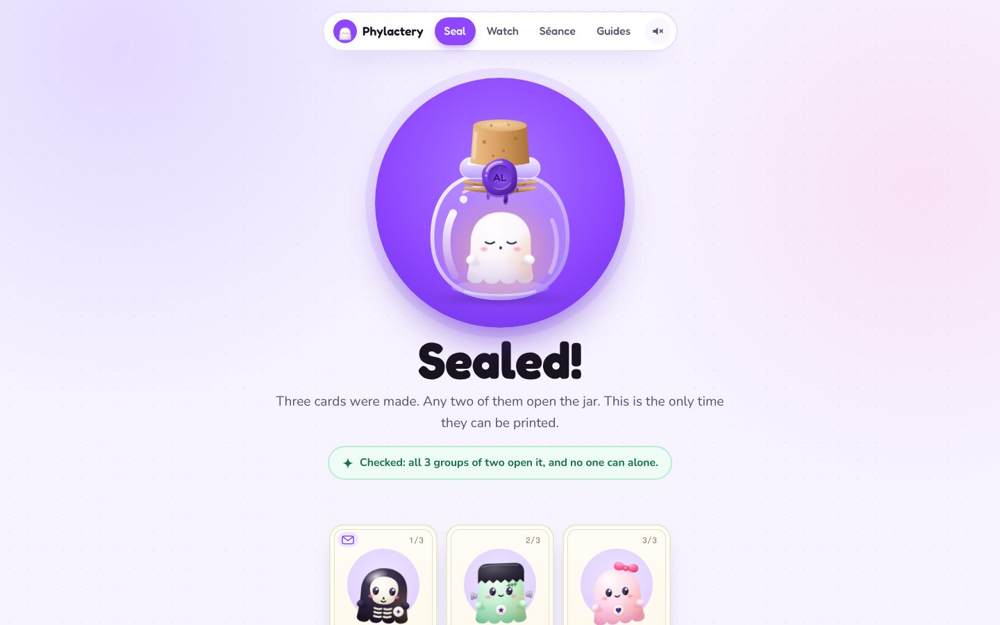
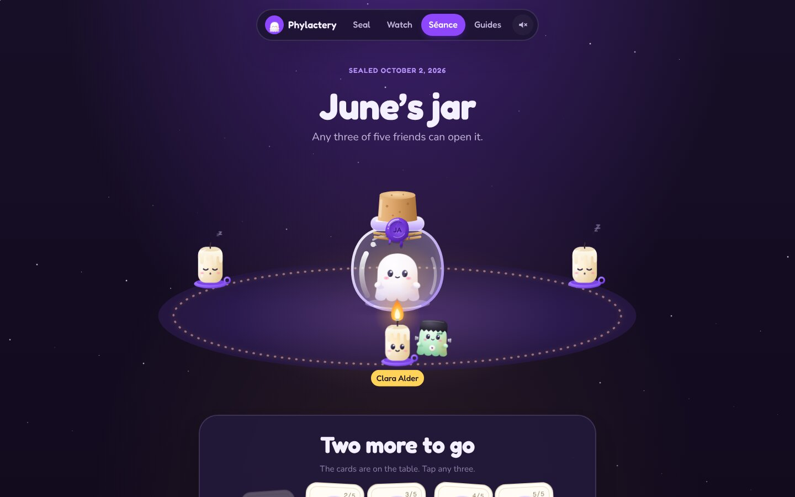
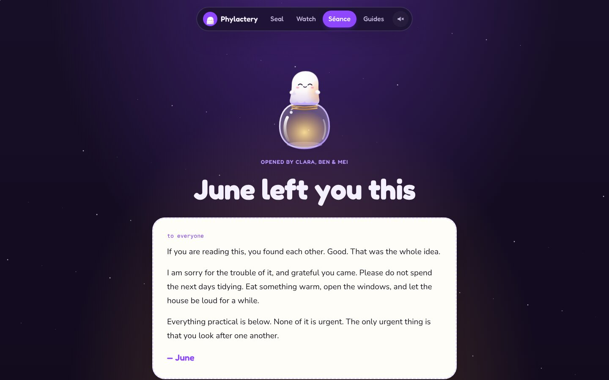
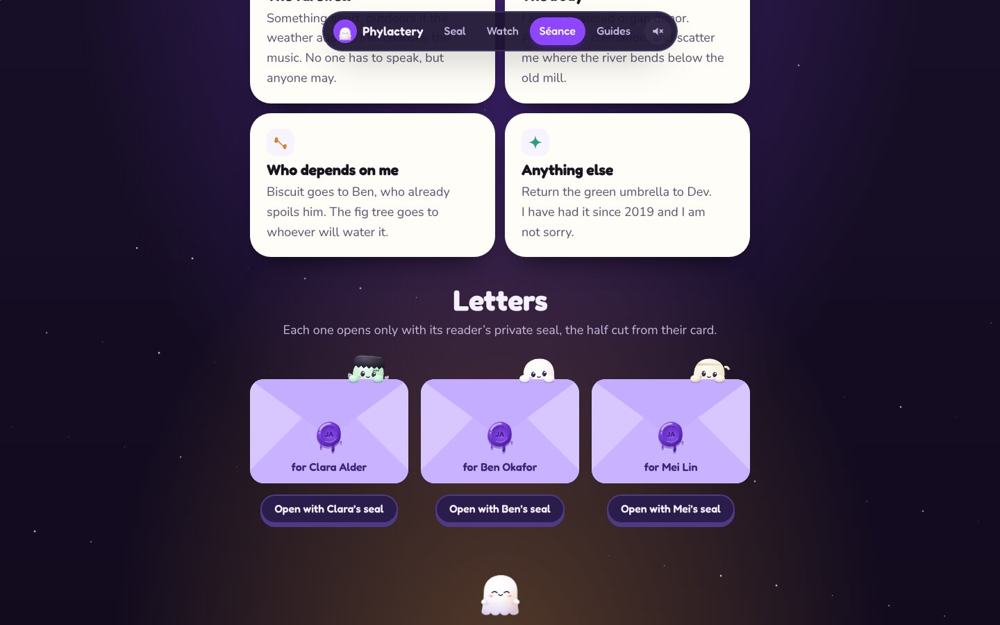
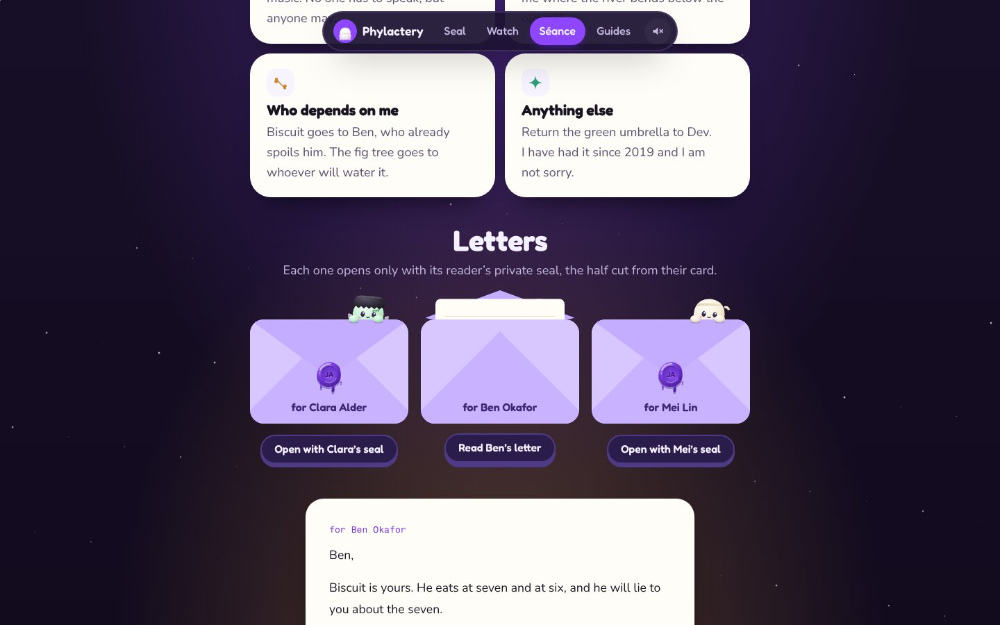
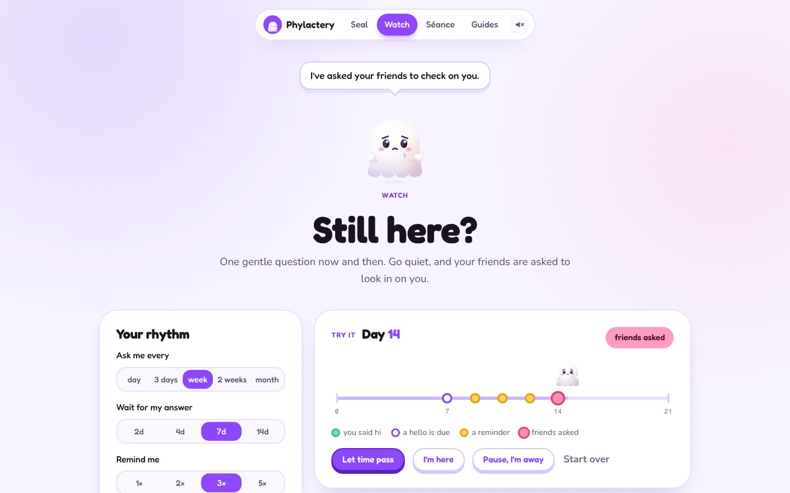
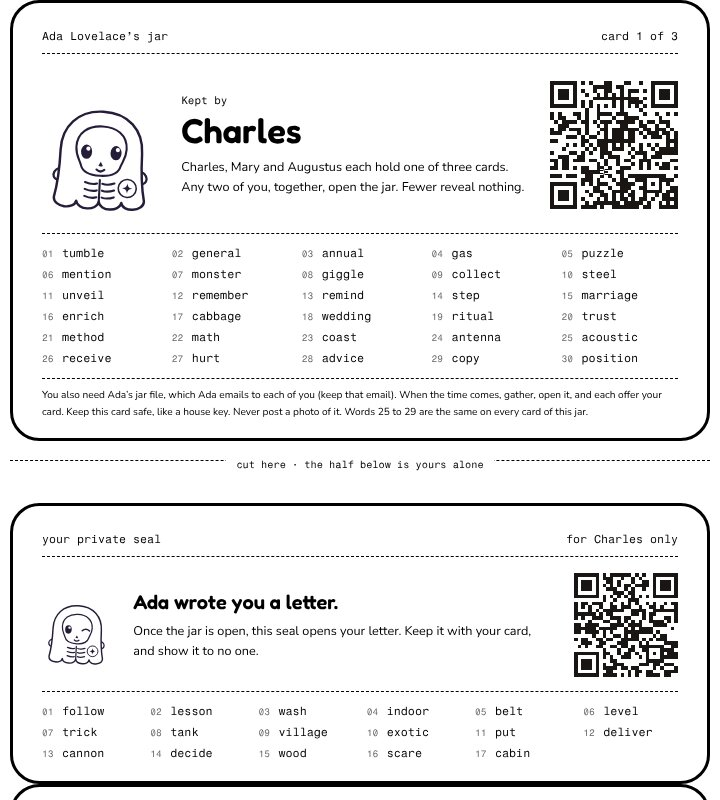
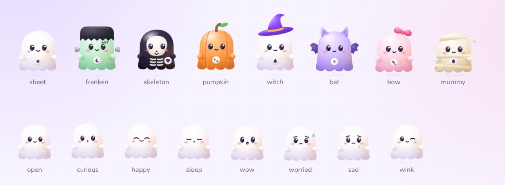

# Phylactery

**A tiny ghost keeps your last words.** Write what your people will need, seal it in a jar, give each friend a card. Only together can they open it.

An entry for [Kiroween 2026](https://kiroween.devpost.com/), **Costume Contest** category.



## Why

When someone dies, the people closest to them are locked out: of accounts, of photos, of the password manager that holds everything else, of the small instructions nobody wrote down. The tools that exist each solve a piece. Check-in apps notice that something happened and stop there. Digital-legacy services keep your secrets on their servers and hand everything to one person. Platform legacy settings are scattered and rarely set up.

Phylactery joins the pieces, and makes a heavy subject gentle: death as a reunion, not a horror story.

## Three acts

**I. Seal.** Write a note for everyone, the accounts you keep and how to get in, where things are, and your wishes. Add a private letter for anyone. Everything is encrypted in your browser and the key is split into one card per friend. You choose how many must gather. Before you print, Phylactery proves it works: every group of that size opens the jar, and no smaller group does. Each friend's page is cut in two: the card, and below it a private seal. Your own page, your key, prints on its own: with it you can change what is inside later, and everyone keeps the card they have.

**II. Watch.** Every so often, one gentle question: *still here?* One tap answers it. Go quiet, and you are reminded. Only then are your friends asked to *check on you*, never told you are gone; they learn who else was asked and how to reach them, who holds the cards and, if you left the watch a locked copy of your jar, get a link to it. Answer late, and they hear that all is well. Once a year, on the Day of the Dead (November 2), the watch also asks whether your jar is still up to date.

**III. Séance.** When the time comes, friends bring their cards. Each card lights a sleepy candle and its little ghost buddy floats in. When enough candles are lit, the wax seal cracks, the cork pops, and the ghost wakes up and hands over your words. Each letter then opens only with the private seal cut from its reader's card.

| | |
|---|---|
|  |  |
|  |  |
|  |  |

| | |
|---|---|
|  |  |

## The costume

Kiroween purple and a cast of little ghosts drawn as SVG, shaded like soft vinyl toys. The rules are short: one character, one headline and one action per screen; the Halloween lives in the cast (eight costumes, one per friend), the candles, the jar and the night, never in props added for decoration. Every spooky element does a job:



| Element | What it tells you |
|---|---|
| A card's ghost buddy | A visual fingerprint. Each card in a circle gets its own costume and emblem, derived from the jar and the card, so the ghost on screen must match the ghost on paper |
| Sleepy candles | Unlock progress: each card wakes one candle |
| The ghost in the jar | Awake while you write; asleep once corked and sealed; stirring as candles light; out and happy when open, with your words flying out as little notes |
| The ring on the rug | Warms to amber as the circle gathers |
| The wax seal | Pressed when the jar is encrypted, cracked when it opens |
| The watch ghost's face | The watch state: happy, asking, worried, or holding up a sign for your friends |
| Day and night | A starry night when you arrive and when friends gather; lilac paper while you write and keep watch. Night falls from the top of the screen and lifts the same way |

Motion marks a change of state, and is springy and small: the cork drops in and the wax is stamped, a tapped card glows and its ghost flies to a candle, the candle wakes, the seal cracks and the cork spins away, envelopes open and letters slide out. Only the ghost in focus and lit flames move on their own. All sounds (a match, a flame, wax pressed and cracking, a bell) are synthesised live with the Web Audio API; there are no audio files, and sound is off until you turn it on. With *reduce motion* set, every state is kept and the movement is dropped. Printed cards are black-and-white line art.

## Three promises

1. **No one opens it alone.** Not one friend, not a company, not us. The 256-bit key is split with Shamir's Secret Sharing; fewer cards than the threshold reveal nothing. (You can, with your own key, to change it.)
2. **Nothing leaves your hands unlocked.** No accounts, no analytics, no requests to other servers. The watch service knows names, email addresses and times, and, only if you choose, holds a locked copy of your jar for your friends.
3. **It outlives us.** Sealing makes a jar file: this whole app as one HTML file with your encrypted jar inside, under a Content Security Policy that forbids any network access. It opens offline, years from now, even if this website is gone.

## Try it

- **June's jar.** Open *Séance* and choose *June's jar*. Click any three cards on the table, or type a card's 30 words. Then open a letter with that person's seal.
- **Seal your own.** Open *Seal*, write, choose your circle, seal, and print the cards (one page per friend; cut off the seal half) and then, on its own, your key.
- **Change it later.** Open *Seal*, choose *Change what's inside*, give it your jar file and your key, edit, and seal again. The same cards open the new words.
- **The watch.** Open *Watch* and press *Let time pass* to see the rhythm. Where the watch service runs, start a real watch below it.

### Run it locally

```bash
npm install
npm run dev        # the app, without the watch service
npm run build      # dist/index.html, one self-contained file
npm run serve      # the built app plus the watch service on http://localhost:8787
npm run check      # types, lint, tests, build, and the end-to-end walk-through
```

Node 22 or later. `npm run serve` keeps watches in `.data/watches.json` and writes mail to `.data/outbox.json` (also at `/api/dev/outbox`) instead of sending it, unless `RESEND_API_KEY` and `MAIL_FROM` are set.

### Deploy

- **GitHub Pages** (static; everything but the real watch): enable Pages with *GitHub Actions* as the source; `.github/workflows/pages.yml` deploys `main`.
- **Netlify** (everything, including the watch): connect the repository; `netlify.toml` builds the app, serves the service from `netlify/functions` with Netlify Blobs storage and an hourly tick. Set `RESEND_API_KEY`, `MAIL_FROM` and `TICK_SECRET`.

## Security model

| Who | What they can learn |
|---|---|
| Anyone holding the jar file | The owner's name, the friends' names, the date sealed, how many cards are needed. Everything else is AES-256-GCM encrypted |
| One friend, or any group smaller than the threshold | Nothing more. Shamir shares below the threshold carry no information about the key |
| A private seal on its own | Nothing. It only works together with an opened jar |
| The circle, once gathered | The jar, but not the private letters: each needs its reader's seal |
| The watch service | Names, email addresses, the rhythm and the times you checked in. If you choose, a locked copy of your jar: its readable header (your name, your friends' names, how many cards are needed) and ciphertext. Never a card, a seal or your key, so never what is inside |
| Someone who steals enough cards | The jar, but still not the letters. Keep cards like house keys |
| Someone who finds your key | Everything, as you could, letters included. It is meant for you alone: keep it like a passport, apart from the cards |

The readable header of a jar is bound to every ciphertext as additional authenticated data, so editing it breaks decryption. Every key in a jar (the master key that the cards share, and each holder's seal) is derived with HKDF from one random seed, which is printed only on your key. That is what lets you reseal new words under the same master key and the same seals; a new jar file carries a higher revision number. Every card carries a SHA-256 checksum, in its QR code and in its words, so a mistyped word is caught.

The watch service sends nothing until the owner confirms their address, stores its tokens only as SHA-256 hashes, rotates check-in links with each batch of questions, gives friends an opt-out link (a friend who opts out keeps their link to the jar), sends a lost manage link again only to the owner's own address and at most once an hour, and allows at most three watches per address. Every email is plain text with an HTML copy that adds one button for the one thing it asks, and no images, tracking pixels or remote styles. When friends are asked to check on the owner, each email says who else was asked, with their addresses so they can gather (the form says so), who holds a card, and how the circle would open the jar; if the owner left a locked copy, each friend gets their own link to it, so no one has to keep a file safe for years.

Limits worth knowing: this is browser cryptography; the app as a whole has not had an independent audit (the Shamir library has, by Cure53 and Zellic); print spoolers and screenshots can keep copies of cards; a malicious browser extension can read any page. **The wishes in a jar are not a legal will.**

## Built with

- React 19, TypeScript, Vite; the app builds to a single HTML file via `vite-plugin-singlefile`
- WebCrypto: AES-256-GCM and HKDF-SHA256
- [`shamir-secret-sharing`](https://github.com/privy-io/shamir-secret-sharing) (Apache-2.0), independently audited
- [`@scure/bip39`](https://github.com/paulmillr/scure-bip39) word list and [`@noble/hashes`](https://github.com/paulmillr/noble-hashes) (MIT)
- [`qrcode`](https://github.com/soldair/node-qrcode) (MIT) and [`jsQR`](https://github.com/cozmo/jsQR) (Apache-2.0); the browser's `BarcodeDetector` when present
- Fonts: Fredoka, Nunito and Fragment Mono (SIL Open Font License), bundled via Fontsource
- The watch service: standard `Request`/`Response`, Netlify Functions and Blobs, Resend for email
- All illustrations are original SVG drawn for this project

### Tests

`npm test` runs 49 tests, most of them property-based (fast-check), among them:

- any set of cards at or above the threshold opens the jar and returns exactly what was sealed; one card short reveals nothing;
- after the owner changes the jar with their key, any group of the original cards opens the new words, the original seals open the new letters, and the old file still holds only the old words; a key from another jar is refused;
- each letter opens only with its own seal, never with another holder's seal relabelled;
- editing the readable header or the ciphertext breaks the jar;
- every card survives the round trip through its QR text and its words, including sloppy typing;
- buddies in a circle wear different costumes and carry different emblems, and each friend's costume is known from the jar id before sealing, so the ghost shown while writing is the one printed;
- someone who checks in on time never alarms anyone; friends are never asked before the full silence;
- the watch service, with a fake clock: friends' emails name the others and, with a kept jar, carry a link that opens exactly that jar for that friend alone; nothing before confirmation, reminders then friends then "all is well", friends who hold no card told who does, pause, opt-out (the jar link keeps working), a lost manage link sent again only to the owner, rate limits, bad tokens, and the yearly Day of the Dead review (once a year, never in a watch's first month or while friends are being asked).

The property tests caught a real bug: the base32 decoder accepted non-canonical padding bits, so a damaged QR code could decode to the same card. Decoding is now strict.

`npm run e2e` seals a jar, checks the self-check, prints the cards and then the key on its own, downloads the jar file and opens it from disk with two typed cards, opens a letter with a typed seal, runs June's séance and the watch preview, changes the jar with the printed key and opens the new file with the original cards, does a whole seal, séance and letter with the keyboard alone, starts and confirms a real watch against a local server, checks phone layouts, and runs axe-core accessibility audits on eight screens (no serious or critical WCAG 2 A/AA issues allowed).

## Project layout

```
src/core/            cards, jars, buddies, the watch schedule, and their tests
src/watch-service/   the watch service: logic, HTTP handler, adapters, tests
src/pages/           home, seal/, seance/, watch/, guides
src/ui/art/          the cast: ghosts, candles, jar, wax seal, emblems, sparkles
src/ui/              components, styles, sound, the jar file (grimoire), shell
src/demo/            June's jar and its cards (from scripts/make-demo-jar.ts)
server/dev.ts        local server: the app plus the watch service
netlify/functions/   the watch service on Netlify
e2e/                 Playwright walk-through (run.mjs) and screenshots of every state (screens.mjs)
.kiro/               Kiro steering, specs, hooks, custom agents, MCP settings (see .kiro/README.md)
scripts/             the demo jar generator; the offline guard
```

## How it was built

Created from scratch during the Submission Period (October 30 – December 4, 2026). No pre-existing code. Planning and the first implementation were done with Claude Code; development continues in Kiro, and the steering, specs, hooks, custom agents and MCP settings used there live in [`/.kiro`](.kiro) (its README says which specs were written from existing code). A full write-up of how Kiro was used will be added before submission.

## License

[MIT](LICENSE)
